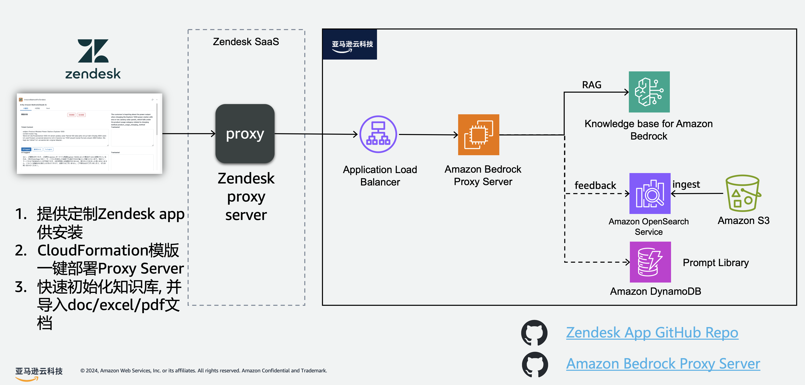
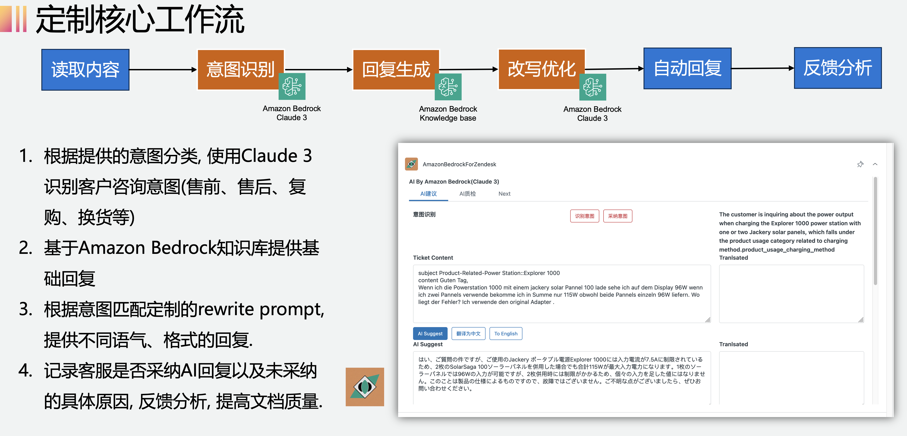
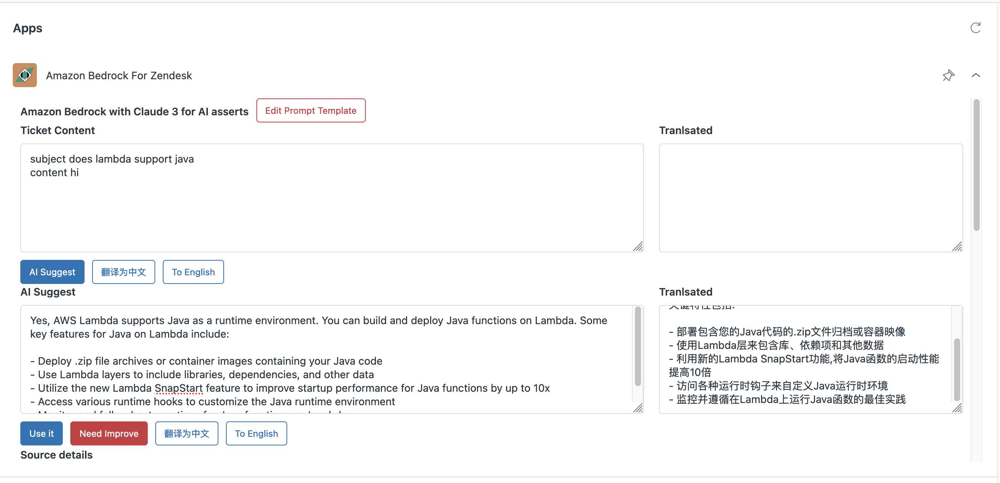
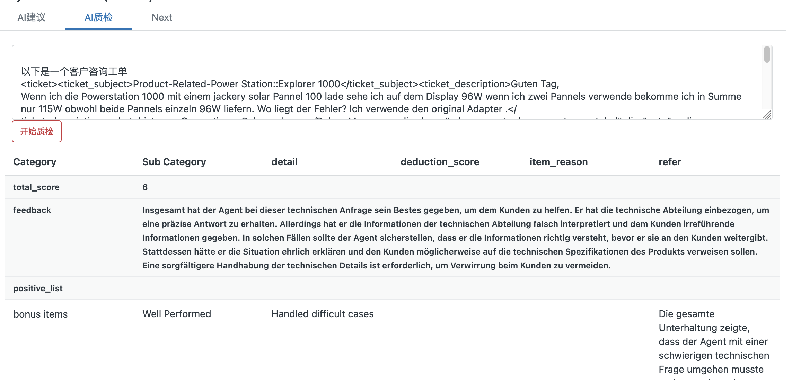

# Amazon Bedrock Zendesk App

*Use of this software is subject to important terms and conditions as set forth in the License file*

基于 Amazon Bedrock 构建智能客服知识库，扩展 Zendesk 客服工作台，提升客服效率与服务质量。

[English](./README_EN.md)

## 目录

- [功能特性](#功能特性)
- [方案优势](#方案优势)
- [系统架构](#系统架构)
- [功能展示](#功能展示)
- [安装部署](#安装部署)
- [开发指南](#开发指南)
- [安全说明](#安全说明)
- [参考资料](#参考资料)
- [许可证](#许可证)

## 功能特性

- **AI 智能回复**
  - 客服工作台扩展集成
  - Ticket 自动生成 AI 回复建议
  - 客服审阅并一键采用
  - 支持反馈机制优化模型

- **AI 质检系统**
  - 自动分析已完结工单
  - 多维度评分分析
  - 客服表现数据统计

- **多语言支持**
  - 内置翻译功能
  - 跨语言咨询理解
  - 多语言回复生成

## 方案优势

### Amazon Bedrock 知识库与 Claude 3 优势

1. **快速部署**
   - 通过 Amazon Bedrock Knowledge Base 提供知识库能力
   - 无预付费，启用成本低

2. **强大的模型能力**
   - 采用 Amazon Bedrock 内置 Embedding 模型
   - 支持日语、英语等多语言市场
   - Claude 3 Sonnet 智能识别咨询意图

3. **精准过滤**
   - 基于 Knowledge Base 的 metadata filter 能力
   - 支持基于 ticket brand 等 label 的准确召回

4. **多语言处理**
   - Claude 3 支持多语言理解（MGSM）
   - 为不同市场提供统一的 AI 能力

## 系统架构

## 功能展示

### 智能回复工作流

1. Claude 3 识别客户咨询意图（售前、售后、复购、换货等）
2. Amazon Bedrock 知识库提供基础回复
3. 根据意图匹配定制的 rewrite prompt，提供个性化回复
4. 记录反馈数据，持续优化系统

### 工作台界面

### AI 质检展示

针对已完结工单，系统自动读取完整对话记录，区分角色并使用 Claude 3 进行多维度评分分析。

## 安装部署

详细安装步骤请参考 [安装指南](./zendesk_install.md)

### 前置条件

- Zendesk 管理员权限
- AWS 账号及相关服务访问权限
- Node.js 环境（开发时需要）

## 开发指南

### 相关资源

- [Zendesk Developer Portal](https://developer.zendesk.com/)
- [Zendesk Apps Tools](https://github.com/zendesk/zendesk_apps_tools)
- [Webpack 文档](https://webpack.github.io)
- [React Support App 开发指南](https://developer.zendesk.com/documentation/apps/build-an-app/using-react-in-a-support-app/)

### 代码提交

代码提交授权请参考：[SSH 配置指南](https://gitlab.pages.aws.dev/docs/Platform/ssh.html)

## 安全说明

本应用采用 Zendesk 官方推荐的安全实践：

1. 使用 metadata 进行安全配置，详见 [Zendesk 安全设置文档](https://developer.zendesk.com/documentation/apps/getting-started/setting-up-new-apps/)
2. 实施必要的访问控制和权限管理
3. 数据传输采用加密方式
4. 定期安全审计和更新

## 参考资料

- [Knowledge Bases for Amazon Bedrock - 完全托管支持的端到端RAG](https://aws.amazon.com/cn/bedrock/knowledge-bases/)
- [Amazon Bedrock 知识库支持元数据过滤以提高检索准确性](https://aws.amazon.com/cn/blogs/machine-learning/knowledge-bases-for-amazon-bedrock-now-supports-metadata-filtering-to-improve-retrieval-accuracy/)
- [Amazon Text Embeddings V2](https://aws.amazon.com/cn/about-aws/whats-new/2024/04/amazon-titan-text-embeddings-v2-amazon-bedrock/)

## 许可证

本项目采用 Apache License 2.0 许可证。详细信息请参见 [LICENSE](LICENSE) 文件。

您可以在 http://www.apache.org/licenses/LICENSE-2.0 获取许可证副本。

根据许可证规定，除非适用法律要求或书面同意，本软件按"原样"提供，不提供任何明示或暗示的保证或条件。
